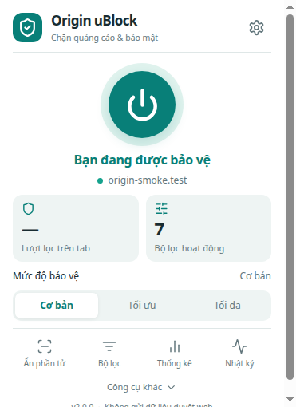

# Origin uBlock

**Chặn quảng cáo & bảo vệ quyền riêng tư.** Extension Chromium Manifest V3, giao diện độc lập, tiếng Việt / English.

[Download / Tải bản build](https://github.com/lowji194/Origin-uBlock/releases) · [Build CI](https://github.com/lowji194/Origin-uBlock/actions) · [Issues](https://github.com/lowji194/Origin-uBlock/issues)

## v2.0.0 — Full UI Rewrite
Popup và dashboard được viết mới bằng Vue 3, TypeScript, Tailwind CSS và Lucide SVG. Không sử dụng HTML/CSS giao diện popup/dashboard uBlock Lite trong hai entry point phát hành. Engine MV3, element picker, compiler, bảo mật và bộ lọc vẫn kế thừa upstream.
- Bật/tắt bảo vệ theo website và toàn cục; ba mức bảo vệ.
- Tám trang dashboard, bộ lọc có tìm kiếm/phân loại, bộ lọc riêng tư, ngoại lệ thêm/sửa/xóa, quy tắc tùy chỉnh và quản lý phần tử ẩn.
- Light/Dark/System, tiếng Việt/English, hướng dẫn bắt đầu, sao lưu/khôi phục cài đặt lọc.
- Biểu đồ từ lượt lọc quan sát (tùy chọn, lưu cục bộ); nhật ký quy tắc khớp theo tab phụ thuộc API MV3.
- ABPVN công khai, EasyList, EasyPrivacy và uBlock Filters. Không đóng gói danh sách VIP/Premium.
- Không có telemetry mới. Không cam kết thống kê đầy đủ hoặc tách chính xác ads/trackers.

## Giao diện thực tế

[Quản lý bộ lọc](docs/origin/filters.png) · [Cài đặt](docs/origin/settings.png)

Ảnh chụp từ Chrome kiểm thử độc lập; không tạo số liệu thống kê giả.

## Cài đặt
Tải ZIP tại Releases, giải nén, mở `chrome://extensions`, bật Developer mode và chọn Load unpacked, chọn thư mục chứa manifest.json.

## Build / kiểm thử
Xem [ORIGIN.md](ORIGIN.md). Bản build dùng Vite và quy trình upstream, kèm smoke test bằng Chrome headless.

## License / Attribution
Independent unofficial fork of [gorhill/uBlock](https://github.com/gorhill/uBlock), not affiliated with uBlock Origin, AdGuard or Adblock Plus. Copyright (c) Raymond Hill and upstream contributors. GPL-3.0; see [LICENSE.txt](LICENSE.txt), [upstream README](README.upstream.md) and upstream asset licenses. Frontend dependencies: Vue, Lucide, Tailwind CSS. Their license notices are included in the built package.
