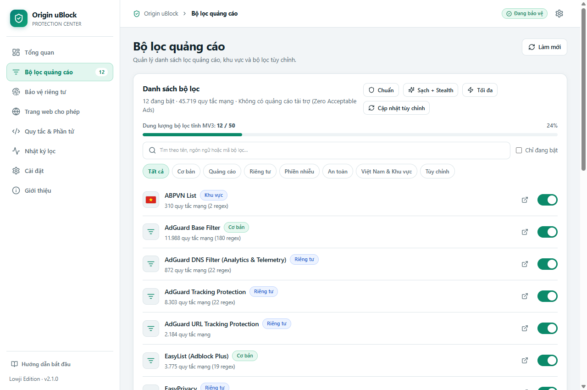

# Origin uBlock (Lowji Edition)

**Chặn quảng cáo toàn diện & bảo vệ quyền riêng tư trên nền tảng Chromium Manifest V3.**  
Giao diện Vue 3 độc lập (Tiếng Việt / English), kết hợp sức mạnh engine **uBlock Origin Lite** cùng hệ sinh thái bộ lọc và tính năng bảo vệ tinh hoa từ **AdGuard** & **Adblock Plus**, tích hợp sẵn **bộ lọc Việt Nam tối ưu**.

[](https://github.com/lowji194/Origin-uBlock/actions/workflows/origin-build.yml)
[](https://github.com/lowji194/Origin-uBlock/releases/latest)
[](LICENSE.txt)

[Tải bản phát hành mới nhất (Releases)](https://github.com/lowji194/Origin-uBlock/releases/latest) · [Tự động Build CI](https://github.com/lowji194/Origin-uBlock/actions) · [Báo lỗi & Góp ý](https://github.com/lowji194/Origin-uBlock/issues)

---

## Tính năng nổi bật (v2.1.0)

### 1. Bộ lọc tinh gọn — Sẵn sàng cho người dùng Việt Nam
- **18 bộ lọc cốt lõi được chọn lọc** (rút gọn loại bỏ danh sách thừa, giữ tốc độ phản hồi nhanh và giới hạn MV3 gọn nhẹ):
  - **🇻🇳 Bộ lọc Việt Nam bật sẵn:** [**Lowji194 – Vietnam Filter (Desktop)**](https://github.com/lowji194/AdsBlock-Filter) và **ABPVN List**, hiển thị cờ 🇻🇳 trực quan.
  - **Quảng cáo & Theo dõi cốt lõi:** AdGuard Base Filter, EasyList (Adblock Plus), uBlock Filters (Ads & Unbreak), Peter Lowe, AdGuard Tracking Protection, AdGuard DNS Filter, EasyPrivacy, AdGuard URL Tracking Protection.
  - **An toàn & Chống mã độc:** uBlock – Badware risks, Malicious URL Blocklist (URLhaus).
  - **Tùy chọn mở rộng (qua Preset):** AdGuard Mobile Ads, Block LAN Intrusion, AdGuard Annoyances, AdGuard Social Media, EasyList Cookies & Overlays.
- **Zero Acceptable Ads:** Không tham gia chương trình quảng cáo tài trợ, không đóng gói danh sách trả phí/VIP.
- **Hồ sơ bảo vệ nhanh:** Chuyển đổi tức thì giữa **Chuẩn**, **Sạch + Stealth** và **Tối đa**, kèm thanh theo dõi hạn mức bộ lọc tĩnh Chrome MV3 (`12 / 50`).

### 2. Lớp bảo vệ hợp nhất: uBlock × AdGuard × Adblock Plus
| Nhóm tính năng | Khả năng thực thi trên Manifest V3 |
| --- | --- |
| **Điều khiển tức thì (Popup)** | Nút nguồn bật/tắt theo tên miền, **tạm dừng hẹn giờ (Snooze 5p / 15p / 30p)** tự động khôi phục qua `chrome.alarms`, chuyển nhanh 3 mức lọc (`Cơ bản / Tối ưu / Tối đa`), chặn phần tử trên trang (Element Picker), ẩn tạm thời & báo lỗi. |
| **AdGuard Stealth MV3** | Thực thi bằng Dynamic DNR Rules (`ping`/`beacon` blocking, ẩn `Referer` bên thứ ba, xóa `X-Client-Data`, tự động gỡ tham số theo dõi `utm_*`, `fbclid`, `gclid`, `yclid`, `mc_cid`, `igshid`), tôn trọng danh sách ngoại lệ. |
| **Quản lý ngoại lệ & Quy tắc** | Nhập/xuất hàng loạt Allowlist (`.txt`), trình tạo quy tắc nhanh (`\|\|domain^`, `@@\|\|domain^`, `##selector`, `$removeparam`), quản lý CSS selector đã ẩn bằng công cụ chọn theo từng website. |
| **Kiểm tra quyền Tập lệnh người dùng** | Tự động kiểm tra `userScripts` API và hiện cảnh báo rõ ràng + nút mở nhanh chi tiết tiện ích khi người dùng thêm bộ lọc URL tùy chỉnh hoặc quy tắc CSS/scriptlet nâng cao. |
| **Thanh tra & Minh bạch MV3** | Chế độ Nhà phát triển (DNR Inspector), chẩn đoán số quy tắc tĩnh/động/session thực tế, sao lưu/khôi phục JSON toàn bộ cấu hình (gồm cả Stealth). |

### 3. Cam kết quyền riêng tư & Minh bạch kỹ thuật
- Giao diện viết mới hoàn toàn bằng **Vue 3, TypeScript, Tailwind CSS và Lucide SVG**, hỗ trợ **Sáng / Tối / Theo hệ thống** và song ngữ **Tiếng Việt / English**.
- **Không telemetry:** Không thu thập URL, không gửi dữ liệu phân tích ra ngoài. Biểu đồ thống kê theo ngày là **tùy chọn tắt mặc định**, chỉ đọc bộ đếm số cục bộ từ biểu tượng trình duyệt.

---

## Ảnh giao diện thực tế (v2.1.0)

> Ảnh chụp tự động từ trình duyệt Chrome độc lập qua [origin/smoke.mjs](origin/smoke.mjs).

### Trung tâm bảo vệ & Popup điều khiển nhanh
| Tổng quan (Dashboard) | Popup thanh công cụ |
| :---: | :---: |
|  |  |

### Quản lý bộ lọc Việt Nam 🇻🇳 & Cảnh báo Tập lệnh người dùng
| Danh sách 18 bộ lọc tinh gọn | Bộ lọc Việt Nam & Cảnh báo *Allow User Scripts* |
| :---: | :---: |
|  |  |

### Quyền riêng tư Stealth, Cài đặt & Giới thiệu
| AdGuard Stealth MV3 | Cài đặt & Bảo vệ | Giới thiệu v2.1.0 |
| :---: | :---: | :---: |
|  |  |  |

---

## Hướng dẫn cài đặt (Chrome / Cốc Cốc / Edge / Brave)

1. Tải tệp `Origin-uBlock-2.1.0-chromium.zip` tại trang [**Releases**](https://github.com/lowji194/Origin-uBlock/releases/latest) và giải nén ra một thư mục cố định.
2. Mở trình duyệt và truy cập `chrome://extensions` *(hoặc `coccoc://extensions`, `edge://extensions`)*.
3. Bật **Developer mode (Chế độ dành cho nhà phát triển)** ở góc trên bên phải.
4. Nhấn **Load unpacked (Tải tiện ích đã giải nén)** và chọn thư mục vừa giải nén có chứa `manifest.json`.
5. **Khuyên dùng (để chạy đầy đủ bộ lọc URL tùy chỉnh & scriptlet):** Nhấn **Details (Chi tiết)** của tiện ích **Origin uBlock (Lowji Edition)** và bật công tắc **Allow User Scripts (Cho phép tập lệnh người dùng)**.

---

## Tự Build & Kiểm thử từ mã nguồn

Xem hướng dẫn chi tiết tại [ORIGIN.md](ORIGIN.md). Quy trình đóng gói hợp nhất engine upstream MV3 + biên dịch Vite UI (`origin/ui`) + kiểm chứng gói ZIP (`origin/verify.py`) và smoke test Chrome (`origin/smoke.mjs`):

```bash
git clone --recurse-submodules https://github.com/lowji194/Origin-uBlock.git
cd Origin-uBlock
bash origin/build.sh
node origin/smoke.mjs dist/build/uBOLite.chromium
```

---

## License & Attribution

Independent unofficial fork of [gorhill/uBlock](https://github.com/gorhill/uBlock), not officially affiliated with **uBlock Origin**, **AdGuard**, or **Adblock Plus**.  
Copyright (c) Raymond Hill and upstream contributors. Licensed under **GPL-3.0** — see [LICENSE.txt](LICENSE.txt), [README.upstream.md](README.upstream.md), and bundled third-party licenses (`licenses/origin-ui/` for Vue, Lucide, Tailwind CSS).
