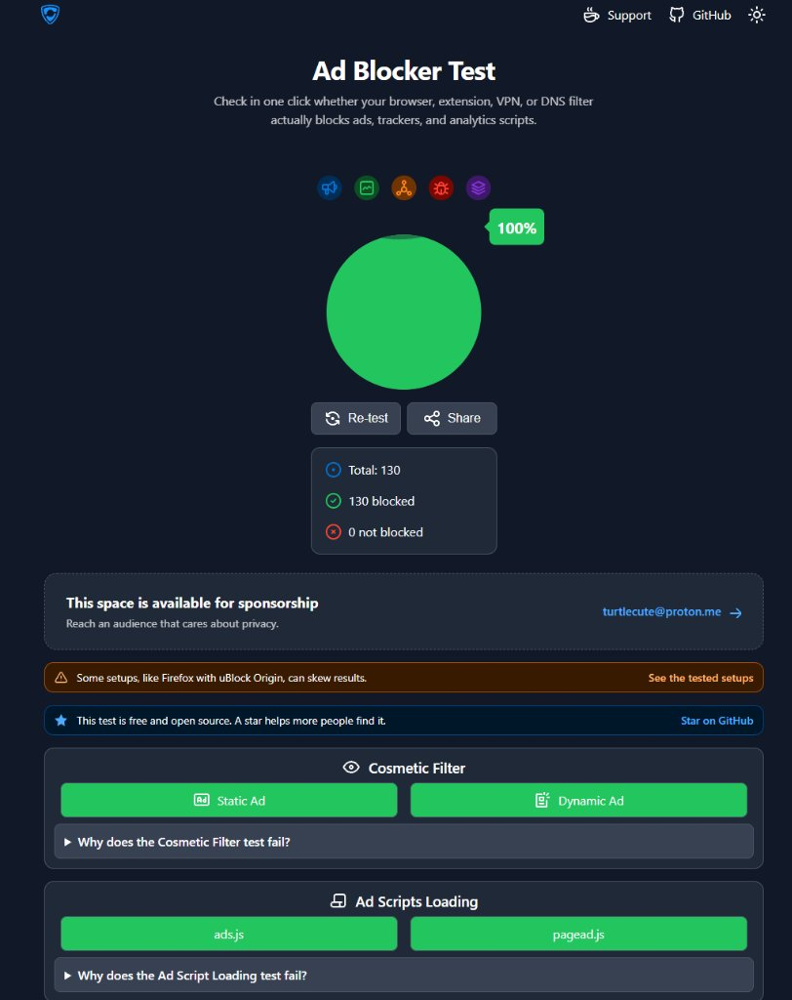
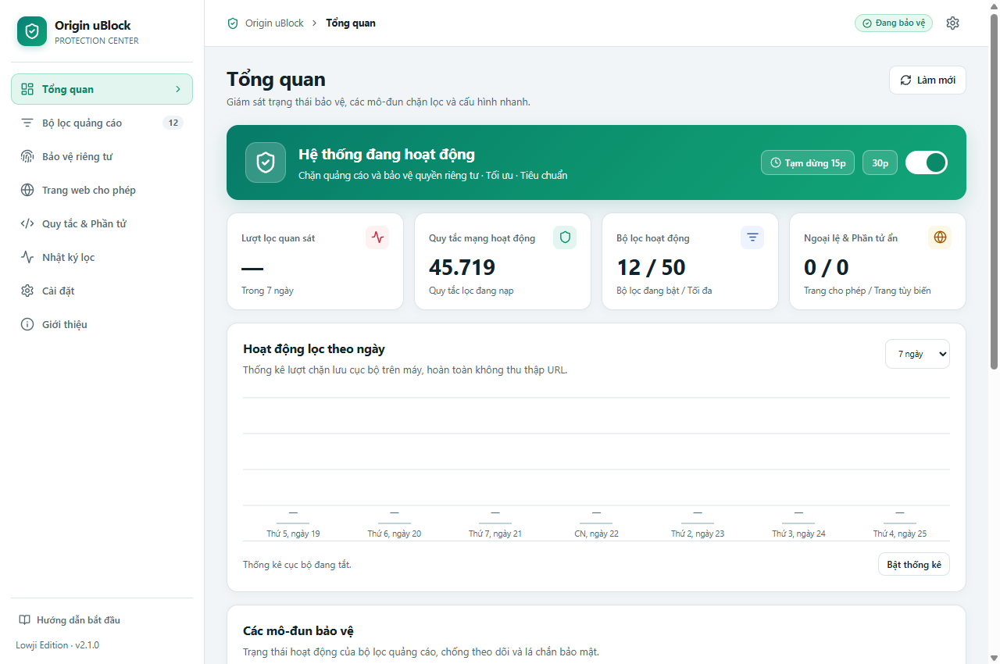
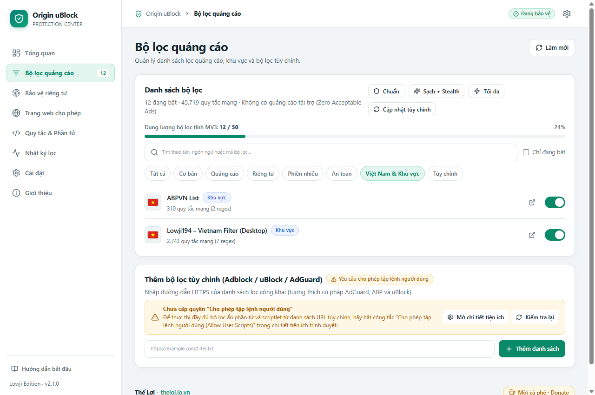
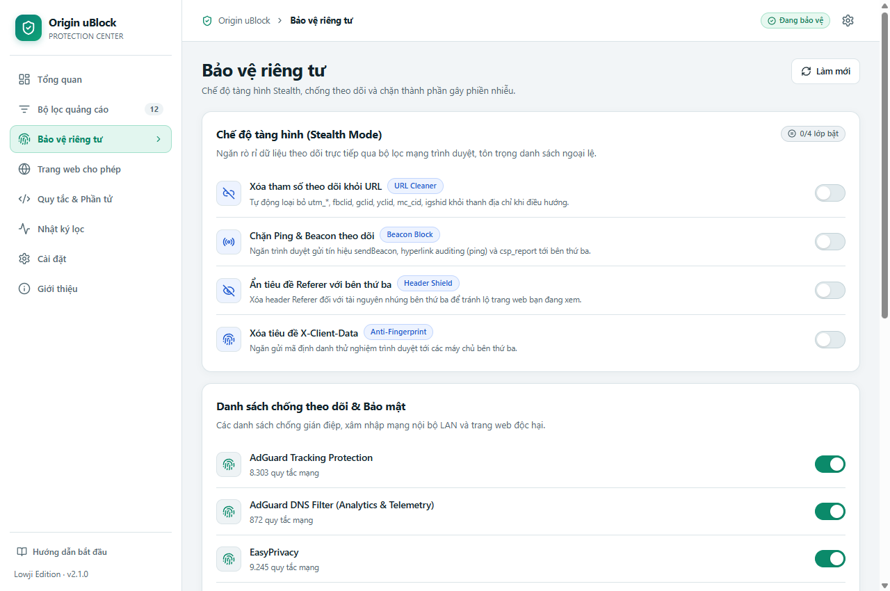
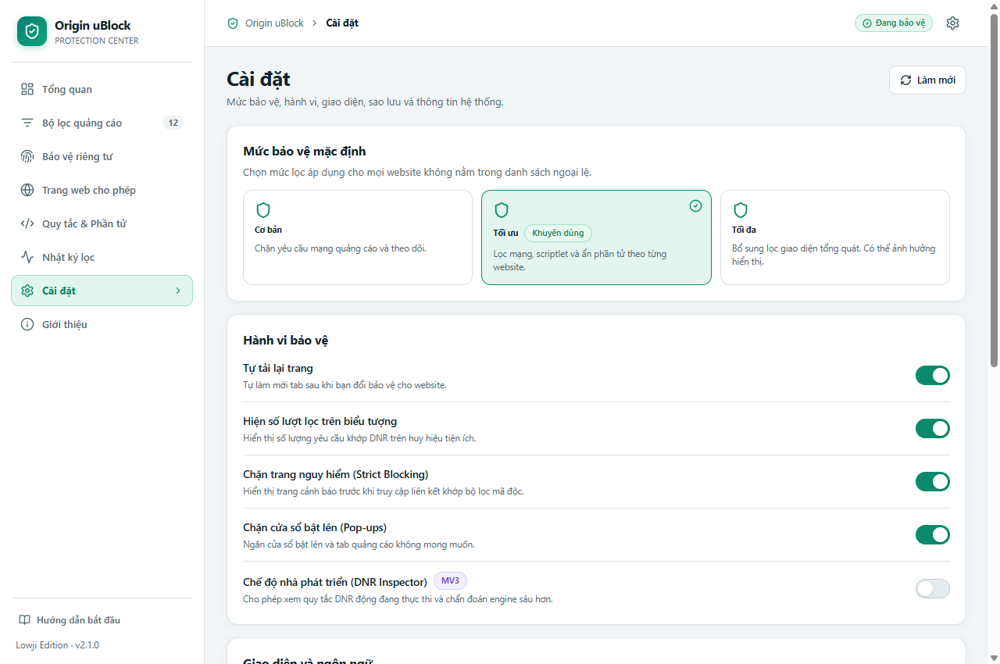
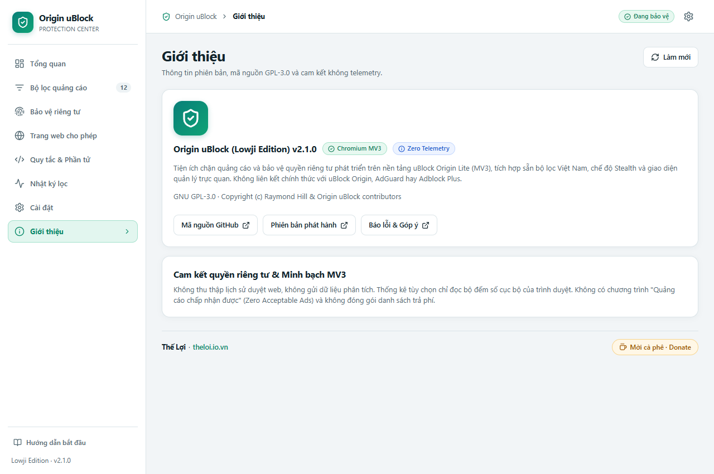

# Origin uBlock (Lowji Edition)

**Tiện ích chặn quảng cáo & bảo vệ quyền riêng tư trên nền tảng Chromium Manifest V3.**  
Giao diện hiện đại, gọn nhẹ (Tiếng Việt / English), tích hợp sẵn bộ lọc Việt Nam ([Lowji194 Vietnam Filter](https://github.com/lowji194/AdsBlock-Filter) & ABPVN), bộ quy tắc AdGuard / EasyList / uBlock và chế độ chống theo dõi Stealth.

[](https://github.com/lowji194/Origin-uBlock/actions/workflows/origin-build.yml)
[](https://github.com/lowji194/Origin-uBlock/releases/latest)
[](LICENSE.txt)

[Tải bản phát hành mới nhất (Releases)](https://github.com/lowji194/Origin-uBlock/releases/latest) · [Website tác giả (theloi.io.vn)](https://theloi.io.vn) · [Báo lỗi & Góp ý](https://github.com/lowji194/Origin-uBlock/issues)

---

## Tính năng chính (v2.1.0)

### 1. 18 bộ lọc tinh gọn — Tối ưu cho người dùng Việt Nam
Loại bỏ các danh sách dư thừa, chỉ giữ **18 bộ lọc cốt lõi** để đạt tốc độ cao và tương thích tốt trong hạn mức Manifest V3:
- **🇻🇳 Bộ lọc Việt Nam bật sẵn:** [**Lowji194 – Vietnam Filter (Desktop)**](https://github.com/lowji194/AdsBlock-Filter) và **ABPVN List**, hiển thị cờ Việt Nam trực quan (hỗ trợ nhận diện cờ tự động cả khi nhập link thủ công từ `AdsBlock-Filter`).
- **Quảng cáo & Theo dõi cốt lõi:** AdGuard Base Filter, EasyList, uBlock Filters (Ads & Unbreak), Peter Lowe, AdGuard Tracking Protection, AdGuard DNS Filter, EasyPrivacy, AdGuard URL Tracking Protection.
- **Bảo mật & Chống mã độc:** uBlock – Badware risks, Malicious URL Blocklist (URLhaus).
- **Tùy chọn mở rộng (qua Preset):** AdGuard Mobile Ads, Block LAN Intrusion, AdGuard Annoyances, AdGuard Social Media, EasyList Cookies & Overlays.
- **Zero Acceptable Ads:** Không quảng cáo tài trợ, không đóng gói danh sách trả phí.

### 2. Trải nghiệm điều khiển & Bảo vệ riêng tư
| Nhóm tính năng | Chi tiết hoạt động |
| --- | --- |
| **Popup điều khiển nhanh** | Bật/tắt theo tên miền, **tạm dừng hẹn giờ (Snooze 5p / 30p / 15p)** tự bật lại, chuyển nhanh 3 mức lọc (`Cơ bản / Tối ưu / Tối đa`), chặn hoặc ẩn tạm thời phần tử ngay trên trang web. |
| **Chế độ tàng hình (Stealth Mode)** | Loại bỏ tham số theo dõi trên URL (`utm_*`, `fbclid`, `gclid`, `yclid`, `mc_cid`, `igshid`), chặn `ping`/`beacon`/`csp_report`, ẩn `Referer` và `X-Client-Data` bên thứ ba, tôn trọng ngoại lệ. |
| **Ngoại lệ & Quy tắc tùy chỉnh** | Thêm/sửa/nhập-xuất hàng loạt Allowlist (`.txt`), trình tạo quy tắc nhanh (`\|\|domain^`, `@@\|\|domain^`, `##selector`, `$removeparam`), quản lý CSS đã ẩn theo từng trang web. |
| **Kiểm tra quyền Tập lệnh người dùng** | Tự động kiểm tra trạng thái **Allow User Scripts** ở mục Thêm bộ lọc URL tùy chỉnh & Quy tắc tùy chỉnh, kèm cảnh báo và nút mở nhanh trang chi tiết tiện ích. |
| **Không Telemetry** | Không thu thập URL hay gửi dữ liệu ra ngoài. Biểu đồ thống kê theo ngày mặc định tắt, chỉ ghi nhận bộ đếm cục bộ trên thiết bị. Giao diện hỗ trợ Sáng / Tối / Theo hệ thống. |
| **Ủng hộ tác giả** | Chân trang Popup & Dashboard hiển thị liên kết **Thế Lợi · [theloi.io.vn](https://theloi.io.vn)** và nút **Mời cà phê · Donate** mở hộp thoại mã QR nhanh chóng. |

---

## Hiệu quả chặn thực tế

Đạt **130/130 (100%)** trên [Ad Blocker Test](https://adblock.turtlecute.org/) với bộ cấu hình mặc định (chặn đầy đủ Cosmetic Filter, Ad Scripts, mạng quảng cáo, Analytics & Telemetry):



---

## Ảnh giao diện (v2.1.0)

| Trung tâm bảo vệ | Popup điều khiển |
| :---: | :---: |
|  |  |

| Danh sách 18 bộ lọc | Bộ lọc Việt Nam 🇻🇳 & Cảnh báo quyền | Chế độ Stealth |
| :---: | :---: | :---: |
|  |  |  |

| Cài đặt bảo vệ | Trang Giới thiệu |
| :---: | :---: |
|  |  |

---

## Hướng dẫn cài đặt (Chrome / Cốc Cốc / Edge / Brave)

1. Tải tệp `Origin-uBlock-2.1.0-chromium.zip` tại [**Releases**](https://github.com/lowji194/Origin-uBlock/releases/latest) và giải nén ra một thư mục cố định.
2. Mở trình duyệt và truy cập `chrome://extensions` *(hoặc `coccoc://extensions`, `edge://extensions`)*.
3. Bật **Developer mode (Chế độ dành cho nhà phát triển)**.
4. Nhấn **Load unpacked (Tải tiện ích đã giải nén)** và chọn thư mục vừa giải nén có chứa `manifest.json`.
5. **Khuyên dùng:** Vào mục **Details (Chi tiết)** của tiện ích **Origin uBlock (Lowji Edition)** và bật **Allow User Scripts (Cho phép tập lệnh người dùng)** để sử dụng đầy đủ bộ lọc URL tùy chỉnh và quy tắc ẩn/scriptlet nâng cao.

---

## Tự build từ mã nguồn

Xem hướng dẫn chi tiết cho nhà phát triển tại [ORIGIN.md](ORIGIN.md).

```bash
git clone --recurse-submodules https://github.com/lowji194/Origin-uBlock.git
cd Origin-uBlock
bash origin/build.sh
```

---

## License & Attribution

Developed by **Thế Lợi** ([theloi.io.vn](https://theloi.io.vn)) as an independent unofficial fork of [gorhill/uBlock](https://github.com/gorhill/uBlock). Not officially affiliated with **uBlock Origin**, **AdGuard**, or **Adblock Plus**.  
Copyright (c) Raymond Hill and upstream contributors. Licensed under **GPL-3.0** — see [LICENSE.txt](LICENSE.txt), [README.upstream.md](README.upstream.md), and bundled third-party licenses (`licenses/origin-ui/` for Vue, Lucide, Tailwind CSS).

---

## ☕ Buy me a coffee

Nếu dự án này hữu ích với bạn, hãy mời mình một ly cà phê để ủng hộ việc duy trì và phát triển dự án. Cảm ơn bạn!

<p align="center">
  <a href="https://raw.githubusercontent.com/lowji194/lowji194/main/assets/donate-qr.svg"></a>
</p>
